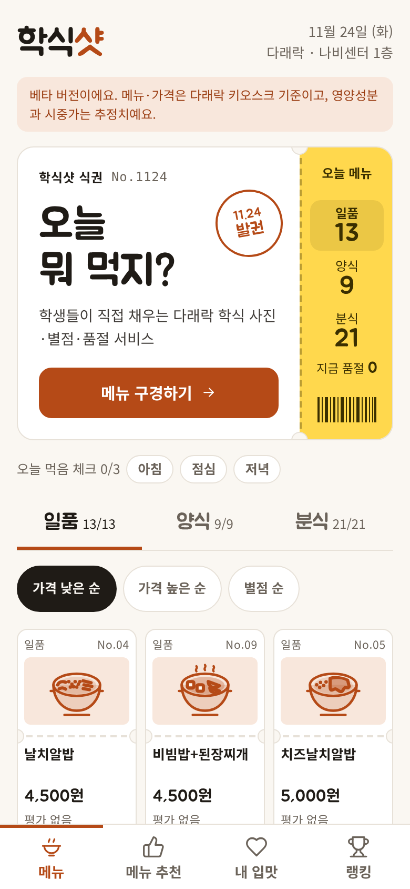

# 학식샷

다래락 학식 메뉴의 실제 사진·평가·품절 정보를 모두가 함께 채우는 웹 서비스.
화면은 정적 HTML, 데이터·사진·익명 로그인·AI 확인은 Supabase, 배포는 Vercel.

**바로 써 보기: https://haksikshot.vercel.app**

**개발 블로그 (노션)**: [학식샷 개발 블로그](https://app.notion.com/p/4088857400b38157bf68e19c3e2fcd7a) · 1편 주제 제안 · 2편 GitHub·서버 연결 · 3편 테스트와 강의 적용 · 4편 자동 테스트·도커 전체 실행·사용 평가

<p>
  
  
  
</p>

### 메뉴 아이콘

메뉴 카드는 SVG 아이콘으로 보여 주고, 실제 사진은 카드를 눌러 상세 화면에서 봅니다.
아이콘 43개는 45도 위에서 내려다본 구도로, 그릇(뚝배기·면 그릇·접시·철판·공기)과 그 안의 내용물로 메뉴를 구분합니다.
메뉴 이름으로 자동 선택되므로 DB에 새 메뉴를 추가해도 가장 가까운 그림이 나옵니다. (`js/icons.js`)


```
index.html                           화면 뼈대 (HTML만)
css/app.css                          스타일
js/data.js                           메뉴 기본 목록·맛 태그·시중 가격
js/core.js                           상태 저장, 한국 시간 날짜, 공통 도우미
js/icons.js                          메뉴 아이콘 SVG 43종 (45도 구도, 이름으로 자동 선택)
js/mascot.js                         캐릭터 밥톨이 (고민·환영·맛있음·아쉬움 표정)
js/views.js                          계산(추천·가성비)과 탭·상세 화면 그리기
js/worldcup.js / js/events.js        메뉴 월드컵 / 버튼·탭 이벤트
sync.js / config.js                  서버 연동 / Supabase 주소·공개 키
supabase/migrations/                 DB 구조 전체 (테이블, 보안 규칙, 함수, 사진 저장소)
supabase/functions/verify-photo      사진·품절 제보 AI 확인 (서버에서 실행)
docker-compose.yml, docker/          전체 스택 로컬 실행 (화면·게이트웨이·API·로그인·저장소·서버 함수·DB)
```

## 사용 평가 설문 (실사용자 테스트)

- 설문: https://haksikshot.vercel.app/survey (앱 화면과 분리된 페이지, 이 링크를 따로 공유)
- 결과: https://haksikshot.vercel.app/results (응답이 들어오면 30초마다 자동 갱신)

문항: 기본 정보(써 본 기간·학식 가는 횟수·기기) → 써 본 기능 → **사용성 척도 SUS 10문항**(필수) → 학식샷 기능 평가 5문항 → **추천 의향 NPS 0~10**(필수) → 주관식 3개.
앱과 같은 익명 로그인이라 1인 1응답(다시 내면 수정)이고, 이름·학번·연락처는 묻지 않습니다.
결과 화면은 DB 함수 `survey_summary()`가 집계한 숫자만 보여 주며, 응답자 중 실제로 앱에 먹음 체크·평가 기록이 있는 사람 수도 따로 셉니다.

## 설정 순서

1. **Supabase 프로젝트 만들기** (리전: Seoul). `Authentication > Sign In / Providers`에서 **Allow anonymous sign-ins**를 켭니다.
2. **DB 만들기**: `supabase/migrations/` 폴더의 파일을 이름 순서대로 `SQL Editor`에 붙여넣고 Run. (CLI가 있으면 `supabase db push`)
   그다음 `supabase/seed.sql`(기본 메뉴 43개)을 한 번 Run.
3. **키 넣기**: `config.js`에 Project URL과 anon key를 넣습니다. (`Project Settings > API`)
4. **AI 사진 확인** (선택, 없으면 사진은 '미확인'으로 올라가고 품절 제보는 막힘):
   [Google AI Studio](https://aistudio.google.com)에서 무료 Gemini 키를 발급받고
   ```bash
   npm i -g supabase && supabase login && supabase link --project-ref <프로젝트ID>
   supabase secrets set GEMINI_API_KEY=<키>
   supabase functions deploy verify-photo --no-verify-jwt
   ```
   모델 순서는 `GEMINI_PRIMARY_MODEL`(기본 `gemini-3.6-flash`) → `GEMINI_MODEL` secret으로 바꿀 수 있습니다.
5. **GitHub에 올리기**
   ```bash
   git init && git add . && git commit -m "학식샷 첫 배포"
   git branch -M main
   git remote add origin https://github.com/<아이디>/haksikshot.git
   git push -u origin main
   ```
6. **Vercel 배포**: vercel.com > Add New Project > 위 저장소 Import > Framework `Other` > Deploy. 이후 `git push`마다 자동 배포됩니다.

## 도커로 실행하기 (프론트·백엔드·DB 전부, 다른 컴퓨터에서 바로)

Docker만 설치돼 있으면 명령 하나로 학식샷 전체가 내 컴퓨터에서 뜹니다. Supabase 클라우드 계정·키가 없어도 됩니다.

```bash
git clone https://github.com/kevin946846-cloud/haksikshot.git
cd haksikshot
docker compose up -d --build      # 처음엔 이미지를 받느라 몇 분 걸림
# 브라우저에서 http://localhost:8080
```

```
브라우저 ──> web (nginx: 화면 + API 게이트웨이, :8080)
               ├─ /rest/v1      ──> rest      PostgREST: DB를 API로
               ├─ /auth/v1      ──> auth      GoTrue: 익명 로그인
               ├─ /storage/v1   ──> storage   사진 저장
               └─ /functions/v1 ──> functions edge-runtime: 사진 AI 확인(verify-photo) ──> Gemini
                                     │
                                    db (Postgres) <── migrate: 처음 뜰 때 supabase/migrations + seed.sql 적용
```

| 서비스 | 이미지 | 하는 일 |
|---|---|---|
| web | 이 저장소의 Dockerfile (nginx) | 화면, `/auth·rest·storage·functions/v1` 을 각 서비스로 넘기는 게이트웨이 |
| db | `supabase/postgres` | 데이터베이스 |
| rest | `postgrest/postgrest` | 앱의 `sb.from(...)`, `sb.rpc(...)` 요청을 SQL로 |
| auth | `supabase/gotrue` | 익명 로그인 |
| storage | `supabase/storage-api` | 메뉴 사진·품절 증거 파일 |
| functions | `supabase/edge-runtime` | `supabase/functions/verify-photo` 실행 |
| migrate | `supabase/postgres` | 마이그레이션·기본 메뉴 적용 후 종료 (다시 띄워도 이미 적용한 파일은 건너뜀) |

- 운영(haksikshot.vercel.app)과 **같은 코드·같은 DB 구조**입니다. 운영은 이 백엔드 부분을 Supabase 클라우드가 돌리고, 로컬은 같은 오픈소스 구성 요소를 Compose로 돌립니다. 데이터는 따로라 로컬에서 무엇을 해도 운영에 영향이 없습니다.
- 구성은 [Supabase 공식 self-hosting](https://github.com/supabase/supabase/tree/master/docker)에서 학식샷이 쓰는 것만 골랐습니다. 관리 화면·실시간·로그 분석은 빼서 가볍고, 실시간 갱신 대신 30초마다 다시 받기로 동작합니다.
- **사진 AI 확인**: `.env.example`을 `.env`로 복사하고 `GEMINI_API_KEY`를 넣은 뒤 `docker compose up -d`. 키가 없으면 사진은 '미확인'으로 올라가고 품절 제보는 막힙니다.
- 끄기: `docker compose down` / 데이터까지 지우고 처음부터: `docker compose down -v`
- 8080 포트가 이미 쓰이면 `.env`에 `WEB_PORT=8090`, `PUBLIC_URL=http://localhost:8090`
- 화면만 따로 띄우기(운영 Supabase에 연결): `docker build -t haksikshot . && docker run -p 8080:8080 haksikshot`
- GitHub Actions가 PR마다 Compose로 전체를 띄우고 E2E 테스트를 돌립니다 (`.github/workflows/e2e.yml`)

## 성능: 캐시와 인덱스

| 무엇 | 어디에 | 효과 |
| --- | --- | --- |
| 마지막으로 받은 데이터 캐시 | 브라우저 localStorage (`haksikshot-snap-v2`) | 앱을 다시 열면 네트워크를 기다리지 않고 바로 그림, 그 뒤 새 데이터로 교체 |
| 스크립트 캐시 | `vercel.json`, `docker/nginx.conf` | `css/`·`js/`·`sync.js`·`config.js`는 10분 캐시, `index.html`은 항상 새 버전 확인 |
| 백그라운드 탭 | `sync.js` | 탭이 안 보일 때는 30초마다 다시 받지 않음 |
| DB 인덱스 | `supabase/migrations/…_baseline.sql` | 주간 집계(meals.created_at), 투표(votes.week), 품절·사진(created_at) |

## 서버가 지키는 규칙
- 하루 3끼, 같은 메뉴 하루 1번 (DB 제약) / 1인 1메뉴 1평가
- '먹음 인증' 표시는 서버가 계산 (먹음 체크한 메뉴의 후기만)
- 사진은 오늘 먹음 체크한 사람만, 최근 7일 안 사진이 있으면 거절 (Edge Function)
- 사진·품절 기록은 클라이언트가 직접 쓸 수 없음 (service role만)
- 품절 표시는 매일 19시(한국 시간) 기준으로 이전 제보를 숨김

## 복구 코드
내 입맛 탭 맨 아래에서 코드를 만들고, 새 기기에서 "복구 코드로 입장"에 넣으면 먹음 체크·평가·투표 기록이 옮겨집니다. 이 기기의 현재 기록은 대체되며, 코드를 잃어버리면 복구할 수 없습니다.

## 알려진 한계
- 가입 없이 익명으로 쓰는 구조라, 복구 코드를 만들어 두지 않고 브라우저 데이터를 지우면 기록을 되찾을 수 없습니다.
- 복구 코드를 아는 사람은 그 기록을 가져갈 수 있습니다 (코드는 64비트 무작위, 서버에는 해시만 저장).
- 날짜·끼니·19시 초기화·주차는 휴대폰 시간대와 상관없이 모두 한국 시간 기준입니다 (서버와 같음).
- 메뉴 목록·영양 추정치는 `index.html` 안에 있습니다. 메뉴가 바뀌면 이 파일을 고치세요.
- AI 확인은 1인 하루(한국 시간) 사진 5번, 품절 제보 10번까지입니다. Edge Function secret `FOOD_DAILY_LIMIT`, `SOLD_DAILY_LIMIT`로 바꿀 수 있습니다.
- 사진이나 품절 증거가 바뀌면 예전 파일은 저장소에서 지웁니다. 표에서 가리키지 않는 파일(10분 지난 것)도 업로드 때마다 함께 정리합니다.

## 메뉴판 바꾸기 (코드 수정·배포 없이)

메뉴판은 Supabase `menus` 표에서 관리합니다. `Table Editor > menus`에서 고치면 앱이 10분 안에 받아서 반영합니다.

- 가격·이름·영양 추정치·맛 태그 변경: 해당 행을 고침
- 새 메뉴: 행 추가. id는 `일품 i숫자`, `양식 y숫자`, `분식 b숫자` 형식 (예: `i14`)
- 판매 중단: 행을 지우지 말고 `on_sale`을 `false`로 (예전 먹음 기록·후기가 메뉴 이름을 계속 찾을 수 있게)
- 앱에 내장된 기본 목록(`js/data.js`)은 첫 화면과 서버 장애 때만 쓰입니다. 앱 사용자는 이 표를 고칠 수 없습니다(읽기만 가능)

## DB 구조 관리 (마이그레이션)

테이블 관계: `menus`(메뉴판)를 `meals`(먹음 체크)·`reviews`(후기)·`votes`(가성비 투표)·`photos`(사진)·`sold`(품절)가 `menu_id` 외래 키로 참조하고,
사용자 기록(`meals`·`reviews`·`votes`·`wc_runs`·`recovery`)은 `auth.users`를 참조합니다. 없는 메뉴·없는 사용자 기록은 DB가 거절합니다.

DB 구조는 `supabase/migrations/` 폴더 하나에서 관리합니다. 파일 이름 앞의 숫자 순서대로 적용합니다.

- `20261124013700_baseline.sql`: 2026-11-24 운영 DB를 그대로 뽑은 기준점. 빈 Postgres에 적용해 운영과 같은지 비교해 확인함
- 그 뒤 파일: 기준점 이후 바뀐 것 하나씩
- 규칙: 운영 DB를 대시보드에서 직접 고치지 않고, 항상 이 폴더에 파일을 추가한 뒤 적용 (예전에는 이게 섞여서 버그가 생겼음)
- 예전에 흩어져 있던 SQL은 `supabase/archive/`에 참고용으로만 남김
- PR마다 GitHub Actions(`db`)가 빈 Postgres(PGlite)에 이 폴더를 적용해 보고, RLS·권한·횟수 제한 같은 핵심 규칙을 확인 (`tests/db`)

## 데이터 받는 양 줄이기 (집계 함수)

앱은 30초마다 서버 데이터를 다시 받습니다. 예전에는 후기 최대 3,000개, 월드컵 기록 최대 1,500판, 2주치 투표 전체를 받아 브라우저에서 평균을 계산했는데,
지금은 DB 함수(`menu_rating`, `recent_reviews`, `vote_counts`, `wc_stats`)가 계산해서 **메뉴별 결과만** 보냅니다.
데이터가 아무리 늘어도 받는 양은 "메뉴 수 × 몇 줄" 수준으로 고정됩니다. 후기 글은 메뉴별 최근 20개만 받습니다.

## 외부 CDN 없이 동작

supabase-js 라이브러리와 글꼴(Jua, Noto Sans KR)은 `vendor/`에 들어 있어 jsDelivr·Google Fonts에 접속하지 않습니다.
학교망처럼 CDN이 막힌 곳에서도 도커로 띄우면 화면이 뜹니다. (Supabase 주소 `*.supabase.co`만 열려 있으면 됩니다)
글꼴은 글자 범위별로 잘게 나뉘어 있어 화면에 쓰인 글자 파일만 내려받습니다.

## 자동 E2E 테스트

PR을 올릴 때마다 GitHub Actions가 `docker compose`로 학식샷 전체(화면·API·로그인·사진 저장·서버 함수·DB)를 띄우고, 실제 브라우저(Playwright)로 눌러 보며 34개 시나리오를 확인합니다. 테스트용 DB는 매번 새로 만들어졌다 사라지므로 **운영 DB를 전혀 건드리지 않습니다.**

| 묶음 | 내용 |
|---|---|
| 일반 흐름 (10) | 히어로, 식권 스텁, 아래 탭, 정렬, 먹음 체크, 평가, 투표, 월드컵 |
| 크리티컬 (5) | 하루 3끼 초과, 같은 메뉴 중복 평가, 19시 품절 초기화, 복구 코드로 기록 옮기기, 서버 장애 시 화면 |
| 서버 규칙 (7) | 화면을 거치지 않고 직접 요청해도 RLS·제약 조건·AI 횟수 제한이 막는지 |
| 서버 집계 (2) | 다른 사람 별점·후기·투표·월드컵 결과가 서버에서 합산돼 보이는지 |
| 시간대 (2) | 휴대폰 시간대가 미국·영국이어도 끼니·19시 초기화·주차·오늘 날짜가 한국 시간 기준인지 |
| 메뉴판 (3) | 내장 기본 목록 = DB 메뉴판, 앱은 메뉴판을 못 고침, DB 변경(가격·신메뉴·판매 중단)이 배포 없이 반영 |
| 메뉴 아이콘·캐릭터 (3) | 카드는 SVG 아이콘(43개 모두 다름), 사진은 눌러서 상세에서, 아이콘 잘림 없음, 캐릭터 밥톨이 |
| 사용 평가 설문 (1) | 설문 제출 → 결과 집계, 다시 내면 수정, 남의 응답 읽기·대신 쓰기 불가 |
| 오프라인 대비 (1) | Supabase 말고 바깥 주소를 모두 막아도 화면·글꼴·로그인이 되는지 |

내 컴퓨터에서 돌리기:

```bash
docker compose up -d --build
cd tests/e2e && npm ci && npx playwright install chromium
npx playwright test          # 기본 대상: http://localhost:8080 (로컬 Compose)
```

테스트마다 새 익명 사용자로 들어가고, 끝나면 자기 기록을 지웁니다.
